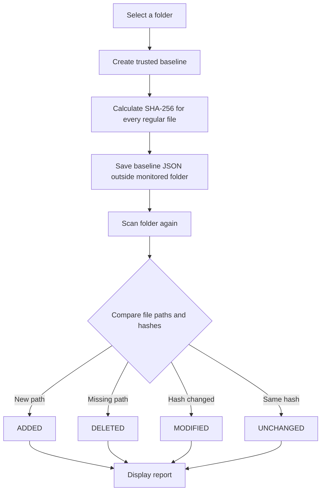

# 🔐 File Integrity Monitor (Python)

[](https://www.python.org/downloads/)


A **beginner-friendly cybersecurity project** that checks whether files in a folder have been **added, changed, or deleted** since a trusted initial snapshot. It uses **SHA-256** cryptographic hashes and only Python's built-in libraries at runtime.

> **Intended use:** Your own files, lab environment, or files you have permission to monitor. This is a learning project, not enterprise endpoint protection or a malware scanner.

## ✨ Features

- 🔒 SHA-256 hashes for file *contents* (not just filenames or timestamps)
- 🗂️ Recursively tracks files in nested folders
- 🚨 Detects **added**, **modified**, and **deleted** files
- 📝 Saves a local JSON baseline; **does not overwrite it during checks**
- 📟 Easy CLI with `init`, `check`, `watch`, and `--json`
- 📊 Clear reports and useful exit codes for scripting
- 🔗 Skips symbolic links so it does not follow linked folders outside the target
- 🧪 Automated tests using `unittest` and a GitHub Actions workflow
- 🪶 No third-party runtime dependencies

## 📂 Project structure

```text
file-integrity-monitor/
├── .github/
│   └── workflows/
│       └── tests.yml            # Tests automatically run on GitHub
├── fim_monitor/
│   ├── __init__.py
│   ├── __main__.py               # Enables python -m fim_monitor
│   ├── cli.py                    # Command-line commands and output
│   └── monitor.py                # Hashing, scanning, baseline, comparison
├── sample_data/
│   ├── config.ini
│   ├── welcome.txt
│   └── documents/
│       └── notes.txt
├── tests/
│   └── test_monitor.py
├── .gitignore
├── LICENSE
├── pyproject.toml
└── README.md
```

## ✅ Requirements

- Python **3.10 or newer**
- Git (only needed to publish on GitHub)
- Any terminal: **Windows PowerShell**, **macOS Terminal**, or **Linux terminal**

Check that Python is installed:

```bash
python --version
```

On systems where `python` is not recognized, try `python3` on macOS/Linux or `py` on Windows in the commands below.

## 🚀 Quick start: 5 commands

Open a terminal **inside the `file-integrity-monitor` folder** after extracting the ZIP.

**1. Create a baseline** (a trusted snapshot of the sample files):

```bash
python -m fim_monitor init sample_data
```

Expected output:

```text
[OK] Baseline saved: .../.fim/baseline.json
Tracked 3 files under .../sample_data
```

**2. Check without changing anything:**

```bash
python -m fim_monitor check sample_data
```

Expected output:

```text
[OK] No changes detected.
Summary: 0 added, 0 modified, 0 deleted, 3 unchanged (3 files currently scanned).
```

**3. Open `sample_data/welcome.txt` in a text editor, change some text, and save it.**

**4. Check again:**

```bash
python -m fim_monitor check sample_data
```

Example output:

```text
[MODIFIED] welcome.txt
Summary: 0 added, 1 modified, 0 deleted, 2 unchanged (3 files currently scanned).
```

**5. Keep monitoring (optional):**

```bash
python -m fim_monitor watch sample_data --interval 5
```

Press **Ctrl+C** to stop. The program rescans every five seconds. It does not update the baseline automatically, so changed files continue to be reported until you intentionally reset it.

### Try detecting added and deleted files

- **Added:** Create `sample_data/new.txt`, then run `check` again.
- **Deleted:** Delete `sample_data/config.ini`, then run `check` again.
- **Reset demo:** Restore original sample files (if using Git, `git restore sample_data`) and recreate the baseline as shown below.

### Accept intentional changes and reset the baseline

When you have **reviewed** the alerts and confirmed that the current files are trusted:

```bash
python -m fim_monitor init sample_data --force
```

**Important:** Do not reset the baseline just to hide a suspicious change; investigate first.

## 🧰 Command reference

| Command | Action |
|---|---|
| `python -m fim_monitor init sample_data` | Create a baseline, refuse to overwrite an existing one |
| `python -m fim_monitor init sample_data --force` | Replace an old baseline after review |
| `python -m fim_monitor check sample_data` | Scan and report changes |
| `python -m fim_monitor check sample_data --json` | Print structured JSON for other tools |
| `python -m fim_monitor watch sample_data` | Repeatedly check until Ctrl+C |
| `python -m fim_monitor watch sample_data --interval 10` | Check every 10 seconds |
| `python -m fim_monitor --help` | Show command help |
| `python -m fim_monitor check --help` | Show options for `check` |

The baseline defaults to `.fim/baseline.json` relative to your **current working directory**. The `.fim/` folder is excluded by `.gitignore`.

You can choose another baseline path:

```bash
python -m fim_monitor init sample_data --baseline private-snapshot.json
python -m fim_monitor check sample_data --baseline private-snapshot.json
```

Keep your baseline **outside the monitored folder**. The CLI refuses a baseline inside it, preventing the baseline from changing the scan results. For example, monitoring `.` with the default baseline *inside* `.` is not allowed. Instead, monitor a subfolder or use a baseline stored outside that folder.

### Optional: install as a local command

If you want to type `fim` instead of `python -m fim_monitor`:

```bash
python -m pip install -e .
fim init sample_data
fim check sample_data
```

This optional install uses packaging tools; **running the project directly requires no `pip install`**.

## 🔍 How it works



**Why SHA-256?** A cryptographic hash provides a compact fingerprint of file contents. If a file's contents change, its SHA-256 hash will almost certainly change. The hash alone does not tell you *who* made the change or whether it was malicious.

**What is a baseline?** The first trusted snapshot of file paths and SHA-256 hashes. Later scans compare current values to this snapshot.

## 🧪 Run the automated tests

From the project root:

```bash
python -m unittest discover -s tests -v
```

Tests use temporary folders so they do not alter `sample_data` or your actual files. The included GitHub Actions workflow runs tests on every push and pull request (on Python 3.10 and 3.12).

## 🧾 JSON output and exit codes

```bash
python -m fim_monitor check sample_data --json
```

Example (after editing `welcome.txt`):

```json
{
  "added": [],
  "deleted": [],
  "modified": ["welcome.txt"],
  "unchanged_count": 2,
  "scanned_count": 3
}
```

| Exit code | Meaning |
|---|---|
| `0` | No changes detected, or `init` completed successfully |
| `1` | Changes detected by `check` (this is expected, not a crash) |
| `2` | An error occurred (bad directory, missing baseline, unreadable files, etc.) |

**Tip:** A CI script can interpret exit code `1` as an integrity alert.

## 🔐 Security notes and limitations

- **Detection, not prevention:** It reports differences; it does not stop attacks, identify malware, or attribute changes to an attacker.
- **Protect the baseline:** Someone who can modify the monitored files *and* the stored baseline could conceal changes. Protect the baseline with appropriate permissions and separate backups.
- **Baseline trust:** Initialize only after verifying the folder contains trustworthy files.
- **Content-only hashing:** This project does not currently detect changes to permissions, owners, timestamps, or extended metadata when content stays the same.
- **Symbolic links:** Skipped to avoid walking unexpected destinations.
- **Polling:** `watch` checks at fixed intervals, not instant kernel-level events. Very brief changes between scans may go unseen.
- **Not hardened against hostile concurrent changes:** Files can change during hashing (a *time-of-check/time-of-use* race), and a local privileged attacker can interfere with monitoring.
- **Read errors:** A scan that cannot read necessary files fails with exit code `2` instead of incorrectly reporting everything as normal.

## 🌱 Ideas for future improvements

- A simple Tkinter graphical interface
- Export CSV reports or format alert timestamps
- Watch individual file permissions as well as contents
- Email/desktop notifications
- Signed or remote read-only baseline storage
- Ignore patterns and efficient rescanning

## 📜 License

MIT — see [LICENSE](LICENSE). You are welcome to personalize the README and extend the code before publishing.
